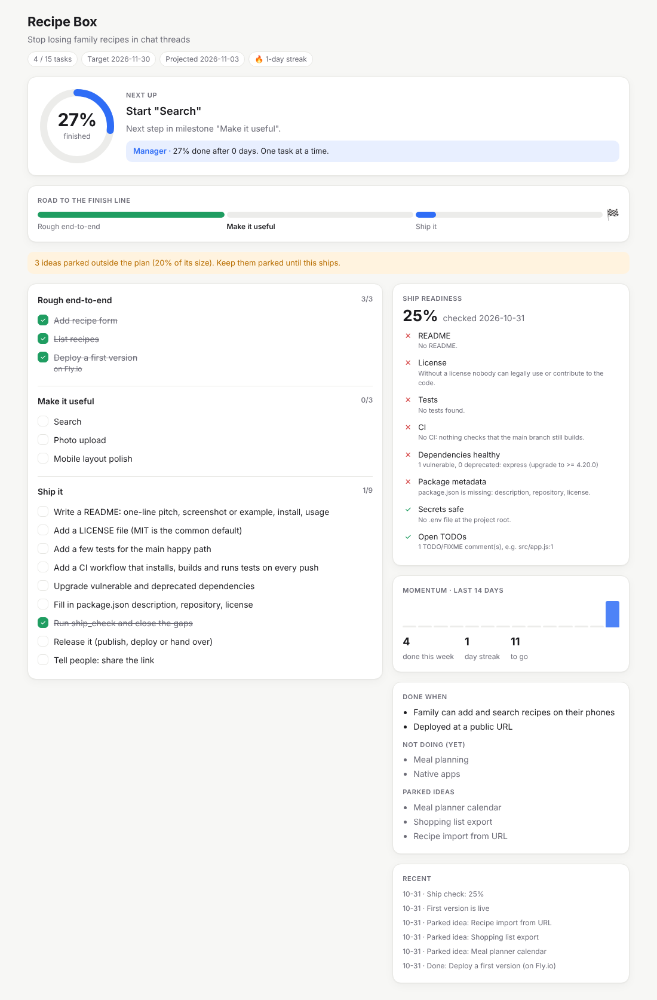

# finishline-mcp

**A project manager for Claude that gets your projects finished, not just started.**

Most side projects don't die from hard problems. They die from a vague goal, scope creep, a task
that silently drags on for a week, and the boring last 20% (README, tests, deploy) that nobody plans
for. finishline gives Claude a manager's job: keep one clear next action in front of you, park
distractions, notice when you're stuck, and walk you through shipping.



## What it does

| | |
|---|---|
| 🎯 **Kickoff interview** | Claude asks what you're building, why, what *done* looks like, what's out of scope, and when. Then it drafts small milestones, starting with a rough end-to-end version. |
| 👉 **One next action** | Never "where was I?". Each session starts with exactly one thing to do, and why. |
| 🅿️ **Scope-creep guard** | New ideas mid-project are parked, not built. You get a warning when the parking lot gets big. |
| 🐢 **Stall detection** | It flags a task that's been in progress for 3+ days and suggests splitting it, notices when you juggle too many tasks, and recaps the project when you return after a break. |
| 📅 **Deadline reality check** | It projects your finish date from recent pace and tells you early if you'll miss the target. |
| 🚢 **Ship check** | Audits README, license, tests, CI, secret hygiene, leftover TODOs, vulnerable or deprecated dependencies (via [fresh-deps](../fresh-deps)) and package metadata. Each gap becomes a task. |
| 📊 **Live dashboard** | Renders inside the chat in clients that support [MCP Apps](https://modelcontextprotocol.io/extensions/apps) (Claude, ChatGPT, VS Code…), where you can check tasks off right there. Everywhere else it is written to `.finishline/dashboard.html`. Light and dark themes, works on phone widths. |

Four tools keep the context cost low: `start_project`, `status`, `update_plan`, `ship_check`.
The plan lives in `.finishline/state.json` in your repo. It's plain JSON, so you can commit it.

## Install

**Claude Code** (run inside your project folder)

```bash
claude mcp add finishline -- npx -y finishline-mcp
```

**Claude Desktop** (`claude_desktop_config.json`). Desktop has no working directory, so point it at the project:

```json
{
  "mcpServers": {
    "finishline": {
      "command": "npx",
      "args": ["-y", "finishline-mcp"],
      "env": { "FINISHLINE_DIR": "/path/to/your/project" }
    }
  }
}
```

Every tool also accepts `project_dir` if you juggle several projects.

## Try it

> "I want to build a recipe app for my family. Help me plan it and keep me on track."

> "What should I work on?"

> "Ooh, what if it also did meal planning?" → *parked for later*

> "Are we ready to ship?"

## Development

From the monorepo root:

```bash
npm install
npm run build
npm run smoke -w finishline-mcp   # full lifecycle against a throwaway project
```

## License

MIT
